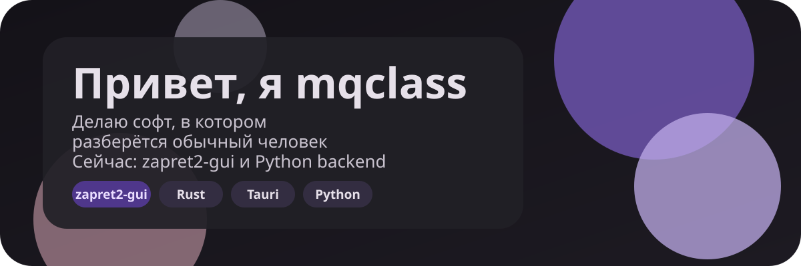

AN EDITORIAL PROFILE · MQCLASS

<picture>
  <source media="(prefers-color-scheme: light)" srcset="https://www.gitskins.com/api/section/hero?username=mqclass&theme=aurora&avatar=https%3A%2F%2Favatars.githubusercontent.com%2Fu%2F248178260%3Fu%3D0f82fd619ca98a1c4c5f6030082aaa3b05969984%26v%3D4&label=mqclass&mode=light" />
  
</picture>

<picture>
  <source media="(prefers-color-scheme: light)" srcset="https://www.gitskins.com/api/section/wordmark?username=mqclass&theme=aurora&avatar=https%3A%2F%2Favatars.githubusercontent.com%2Fu%2F248178260%3Fu%3D0f82fd619ca98a1c4c5f6030082aaa3b05969984%26v%3D4&label=mqclass&v=cinematic-hero-wordmark-1&mode=light" />
  
</picture>

<a href="https://github.com/mqclass">GitHub</a>

─────── ◇ ───────

<table width="100%" style="display:table;width:100%;table-layout:fixed;">
<tr>
<td width="58%" valign="top"><h2>The point of view</h2><blockquote>hi, i'm mqclass. i mostly make minecraft plugins on java, and lately i've been working on zapret2-gui, a windows app that gets youtube and discord working again without messing with .bat files. on the side i'm figuring out devops and mlops stuff, ci/cd and containers, and python backend with fastapi and django.</blockquote>
Small teams, ambitious ideas, and useful collaborations.
</td>
<td width="42%" valign="top">
<code>PROFILE</code>

ROLE · Java plugin developer, Windows desktop BASED · the public internet FOCUS · TypeScript, Rust, Java

if you want to reach me, just open an issue or a discussion in any of my repos.
</td>
</tr>
</table>

─────── ◇ ───────

<h2>In the current cut</h2>

<picture>
  <source media="(prefers-color-scheme: light)" srcset="https://www.gitskins.com/api/section/highlights?username=mqclass&theme=aurora&avatar=https%3A%2F%2Favatars.githubusercontent.com%2Fu%2F248178260%3Fu%3D0f82fd619ca98a1c4c5f6030082aaa3b05969984%26v%3D4&items=TypeScript%3A%3ACurrent%20focus%7CRust%3A%3AIn%20the%20active%20build%20queue%7CLua%3A%3AIn%20the%20active%20build%20queue&v=cinematic-highlights-2&mode=light" />
  
</picture>

The ideas, experiments, and decisions moving the work forward.

─────── ◇ ───────

<h2>Production palette</h2>

<picture>
  <source media="(prefers-color-scheme: light)" srcset="https://www.gitskins.com/api/section/stack?username=mqclass&theme=aurora&avatar=https%3A%2F%2Favatars.githubusercontent.com%2Fu%2F248178260%3Fu%3D0f82fd619ca98a1c4c5f6030082aaa3b05969984%26v%3D4&v=cinematic-stack-2&mode=light" />
  
</picture>

TypeScript · Rust · Lua · Java · Python · CSS · tools chosen for the work, not the trend

─────── ◇ ───────

<h2>Featured reel</h2>

<picture>
  <source media="(prefers-color-scheme: light)" srcset="https://www.gitskins.com/api/section/projects?username=mqclass&theme=aurora&avatar=https%3A%2F%2Favatars.githubusercontent.com%2Fu%2F248178260%3Fu%3D0f82fd619ca98a1c4c5f6030082aaa3b05969984%26v%3D4&repos=mqclass%2Fzapret2-gui&v=cinematic-projects-2&mode=light" />
  
</picture>

<table width="100%">
<tr>
<td width="100%" valign="top">
<strong><a href="https://github.com/mqclass/zapret2-gui">zapret2-gui</a></strong>

Modern desktop supervisor &amp; GUI client for zapret2 (winws2) with WinDivert, tray integration, DPI bypass for YouTube &amp; Discord on Windows

TypeScript · Rust · Lua
</td>
</tr>
</table>

─────── ◇ ───────

## 📊 GitHub Stats & Trophies

  
  

  

  

  

─────── ◇ ───────

## 🛠️ Languages & Tools

> ## Programming Languages

   

> ## Plugin Dev

 

> ## Frontend

 

> ## Backend

> ## Database

  

> ## DevOps

   

─────── ◇ ───────

<h2>Contribution trail</h2>

<picture>
  <source media="(prefers-color-scheme: light)" srcset="https://www.gitskins.com/api/section/heatmap?username=mqclass&theme=aurora&avatar=https%3A%2F%2Favatars.githubusercontent.com%2Fu%2F248178260%3Fu%3D0f82fd619ca98a1c4c5f6030082aaa3b05969984%26v%3D4&style=snake&v=cinematic-snake-1&mode=light" />
  
</picture>

─────── ◇ ───────

THE NEXT SCENE

<h2>Keep the story moving</h2>

if you want to reach me, just open an issue or a discussion in any of my repos.

<picture>
  <source media="(prefers-color-scheme: light)" srcset="https://www.gitskins.com/api/section/social?username=mqclass&theme=aurora&avatar=https%3A%2F%2Favatars.githubusercontent.com%2Fu%2F248178260%3Fu%3D0f82fd619ca98a1c4c5f6030082aaa3b05969984%26v%3D4&v=cinematic-social-2&mode=light" />
  
</picture>

<a href="https://github.com/mqclass">GitHub</a>

  <i>"God's in his heaven, all's right with the world."</i>

  

